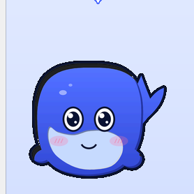
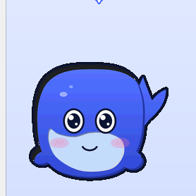
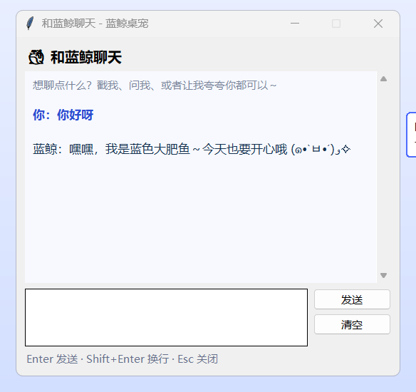
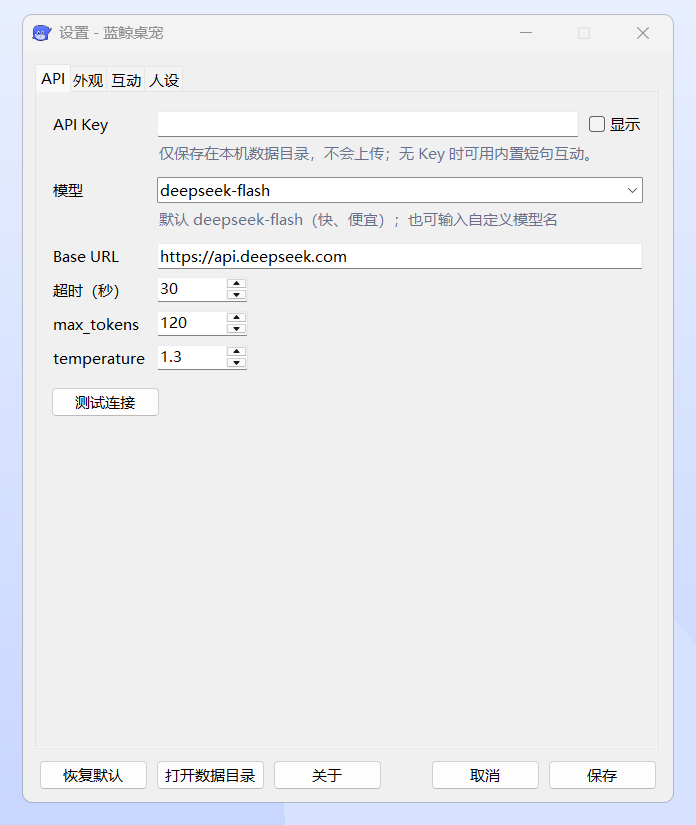
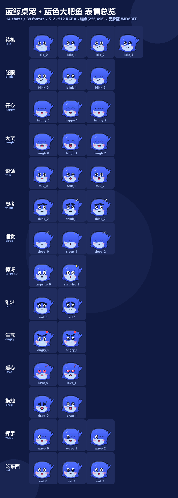

# 🐟 蓝色大肥鱼 · AI 桌宠

> 一只住在你桌面上的**蓝色大肥鱼**：会眨眼、会卖萌、会陪你聊天。
> 接入 **DeepSeek / 智谱 GLM** 双平台 API；Windows 便携单 exe / Windows 安装版 / Debian 包 / Arch 包，全部由同一份 Python 源码构建。


<p align="center">
  
  
</p>

---

## ✨ 功能特性

| | |
| --- | --- |
| 🐟 **蓝色大肥鱼形象** | 38 帧原创二创美术（14 种表情），从 DeepSeek 官方蓝鲸 logo 的轮廓/配色出发程序化重绘：圆胖 Q 版、深色描边、腮红、双叶尾鳍 |
| 💬 **会说话，言简意赅** | **DeepSeek / 智谱 GLM 双平台**，OpenAI 兼容 + SSE 流式打字机输出，系统提示强制 1~2 句 / ≤60 字，可用颜文字 |
| 😊 **14 种表情动画** | `idle / blink / happy / laugh / talk / think / sleep / surprise / sad / angry / love / drag / wave / eat`，随机眨眼、呼吸浮动、闲置入睡 |
| 🖱️ **丰富互动** | 左键戳一戳、双击聊天、**右键拖拽移动**、右键菜单、滚轮缩放（64~320）、托盘菜单 |
| 🪟 **真·桌面宠物** | 无边框、透明、置顶、不抢任务栏；Windows 色键透明，Linux X11 Shape 裁剪（失败自动回退 alpha） |
| ⚙️ **设置自由** | 托盘右键 → 设置：**平台切换（DeepSeek/GLM）**、API Key 分平台保存、模型/Base URL、大小、不透明度、置顶、鼠标穿透、开机自启、气泡时长、自动睡眠、自定义人设 |
| 🪶 **低内存** | 空载实测 **≈46 MB**（开发态）/ **≈48 MB**（便携 exe 父+子）/ 采样峰值 **57 MB**，目标 ≤60 MB |
| 📦 **多平台分发** | Windows 便携单 exe（免安装）、Windows 安装版（含卸载器）、Debian `.deb`、Arch `pkg.tar.zst` + `PKGBUILD` |
| 🔌 **无 Key 也能玩** | 内置本地台词兜底；401/402/429/超时/断网都有中文提示，不崩溃 |

## 📥 下载

| 平台 | 文件 | 大小 | SHA256（前 8 / 后 6 位） |
| --- | --- | --- | --- |
| Windows 便携版（推荐） | [`BlueWhalePet-Portable-1.0.0.exe`](release/windows/BlueWhalePet-Portable-1.0.0.exe) | 21.1 MB | `b095c6a1…1fc5c` |
| Windows 安装版 | [`BlueWhalePet-Setup-1.0.0.exe`](release/windows/BlueWhalePet-Setup-1.0.0.exe) | 31.7 MB | `defbb87e…9c9ee` |
| Debian / Ubuntu | [`blue-whale-pet_1.0.0_all.deb`](release/linux/blue-whale-pet_1.0.0_all.deb) | 1.8 MB | `c773985a…153a4` |
| Arch / Manjaro | [`blue-whale-pet-1.0.0-1-any.pkg.tar.zst`](release/linux/blue-whale-pet-1.0.0-1-any.pkg.tar.zst) | 1.8 MB | `d479574f…93882` |
| Linux 单文件版（可选） | [`BlueWhalePet-Linux-x86_64`](release/linux/BlueWhalePet-Linux-x86_64) | 20.2 MB | `ad0b8d4d…62a3b` |

完整校验值：`release/SHA256SUMS.txt`。

### 安装

```bat
:: Windows 便携版：双击即用（配置写在 exe 同级 BlueWhalePet-Data\）
BlueWhalePet-Portable-1.0.0.exe

:: Windows 安装版：向导安装到 %LOCALAPPDATA%\Programs\BlueWhalePet
BlueWhalePet-Setup-1.0.0.exe
:: 静默安装 / 卸载（可用于批量部署）
BlueWhalePet-Setup-1.0.0.exe /S /D=C:\Tools\BlueWhalePet
"C:\Tools\BlueWhalePet\uninstall.exe" /uninstall /S
```

```bash
# Debian / Ubuntu
sudo apt install ./blue-whale-pet_1.0.0_all.deb

# Arch / Manjaro
sudo pacman -U blue-whale-pet-1.0.0-1-any.pkg.tar.zst
```

> Windows SmartScreen 提示「未知发布者」属正常（未做代码签名），点「更多信息 → 仍要运行」。
> 托盘图标在 Windows 11 默认收进任务栏 `^` 溢出区，可拖到常显区。

## 🚀 快速上手

1. **启动**：桌宠出现在桌面，托盘出现蓝鲸图标；
2. **配置 API Key**：托盘右键 → 设置 → API 页选平台（DeepSeek / 智谱 GLM）→ 填对应 Key（DeepSeek [申请](https://platform.deepseek.com/api_keys)；GLM [申请](https://open.bigmodel.cn/usercenter/apikeys)）→ 测试连接 → 保存；两个平台的 Key 各存一份，随时切换；
3. **互动**：

| 操作 | 效果 |
| --- | --- |
| 左键单击 | 戳一戳：随机表情 + 一句短话（本地台词，秒回） |
| 左键双击 | 打开聊天窗口，`Enter` 发送、`Shift+Enter` 换行 |
| 右键按住拖动 | 移动位置，松手保存 |
| 右键单击 | 小菜单（聊天 / 设置 / 隐藏 / 大小 / 退出） |
| 滚轮 | 放大 / 缩小 |
| 托盘右键 | 设置、显示隐藏、置顶、鼠标穿透、开机自启、关于、退出 |

<p align="center">
  
  
</p>

## 😊 表情一览



## 🧠 技术要点

- **纯 Python + tkinter + Pillow**，无 Electron/Qt/浏览器内核；打包体积小、内存低。
- **透明窗口**：Windows 用 `-transparentcolor` 色键 + Pillow 预合成（边缘深色描边避免毛边）；Linux 用 ctypes 调用 `libX11/libXext` 的 XShape 裁剪，环境不支持时回退 `-alpha`。
- **DPI 友好**：启动即声明 Per-Monitor DPI 感知，尺寸/坐标按逻辑像素存储，125% 缩放下同样清晰、大小正确。
- **表情状态机**：完全由 `assets/mascot/manifest.json` 驱动（14 状态 / 38 帧 / durations / loop / 锚点），替换美术无需改代码。
- **API 调用**：只用标准库 `urllib`，OpenAI 兼容 `POST /chat/completions`（DeepSeek / GLM 双平台预设：切平台自动带出 Base URL 与模型列表），SSE 逐行解析 `delta.content` 与 `[DONE]`，带 `thinking:{"type":"disabled"}` 与 `max_tokens`，上下文保留最近 8 轮；Key 分平台保存。
- **托盘**：Windows 用 ctypes 直接 `Shell_NotifyIconW` + `TrackPopupMenu`（独立消息循环线程，处理 `TaskbarCreated` 重建）；Linux 可选 `pystray`，不可用时用宠物右键菜单兜底。
- **工程化**：单实例（Mutex / 锁文件 + 唤醒通道）、配置原子写与损坏备份、滚动日志、开机自启、`--selftest` 15 项自检、75 个单元测试。

## 📁 目录结构

```text
blue-whale-pet/
├─ src/                  # 应用源码（25 个模块，约 7600 行）
│  ├─ main.py            # 入口 / CLI
│  ├─ app.py             # 应用编排（托盘、设置、聊天、互动）
│  ├─ pet_window.py      # 透明置顶窗口 + 鼠标交互
│  ├─ bubble.py chat.py settings_window.py
│  ├─ anim/              # manifest 解析 / 帧缓存 / 状态机
│  ├─ platform_win.py platform_linux.py tray_win.py tray.py
│  ├─ api.py prompts.py config.py resources.py
│  └─ selftest.py showcase.py single_instance.py autostart.py
├─ assets/               # 美术资产（2.9 MB）
│  ├─ mascot/            # manifest.json + 38 帧 512×512 RGBA
│  ├─ icons/             # app.ico/tray.ico/setup.ico/svg/hicolor
│  ├─ installer/         # 安装器插画
│  ├─ preview/           # 表情总览图
│  └─ source/            # 参考素材与来源说明（不随包分发）
├─ packaging/windows/    # PyInstaller spec + 自研安装器 + build_all.ps1
├─ packaging/linux/      # .deb / Arch PKGBUILD / 构建脚本
├─ qa/                   # 独立 QA 脚本与报告
├─ docs/                 # DESIGN / USAGE / BUILD / 截图
└─ release/              # 最终产物 + 校验值
```

## 🔨 从源码构建

见 [`docs/BUILD.md`](docs/BUILD.md)。一句话版本：

```bash
py src/main.py --selftest                           # 开发态自检
powershell -File packaging\windows\build_all.ps1     # Windows 便携版 + 安装版
bash packaging/linux/build_linux.sh                 # Debian + Arch 包（WSL Debian 13）
```

## ✅ 质量证据

- `qa/QA_REPORT.md`：独立 QA 报告（资产契约、自检、单元测试、内存、截图、交互、安装/卸载往返、包结构校验）；
- `tests/run_tests.py`：75 个单元测试；
- `--selftest`：15 项运行时自检（manifest、配置读写、SSE 解析、窗口、14 表情、戳一戳、气泡、设置窗、托盘、内存）；
- 实测：便携 exe 空载 47.8 MB、交互全流程通过、模拟 DeepSeek API 流式回复成功。

## ❓ 常见问题

**托盘图标找不到？** Windows 11 收进 `^` 溢出区；Linux GNOME 需 AppIndicator 扩展，无托盘时右键宠物可打开菜单。

**聊天报 401 / 402 / 429？** 401 检查对应平台的 Key；402 需充值（DeepSeek）/ GLM 检查资源包；429 限流稍后再试（自动本地台词兜底）。GLM 在 [bigmodel.cn](https://open.bigmodel.cn) 有免费资源包，`glm-4-flash` 有免费额度。

**Linux 上不透明 / 不能置顶？** 需要 X11 或 XWayland；纯 Wayland 下部分合成器限制形状与置顶，建议登录 Xorg 会话。

**想换美术？** 按 `SPEC.md` §4 的尺寸/锚点替换 `assets/mascot/master/*.png` 与 `manifest.json`，重启即可。

更多见 [`docs/USAGE.md`](docs/USAGE.md)。

## ⚖️ 免责声明与许可

- 🤖 **本项目由 DSH（DeepSeek Harness）AI 智能体自主设计并全程创作生成**——包括全部代码、构建脚本、测试与文档；人类仅提出需求与验收。
- 本项目是**非官方**个人作品，与 DeepSeek 官方无关；「DeepSeek」「蓝鲸」名称与形象相关权利归其所有者。美术为参考官方 logo 的程序化二创，仅供学习交流，请勿商用。
- 代码以 MIT 许可发布，详见 [`LICENSE`](LICENSE)；素材来源与处理记录见 [`assets/source/NOTICE.md`](assets/source/NOTICE.md)。
- 与 DeepSeek API 的通信受其服务条款约束；本项目不收集任何遥测数据，API Key 仅保存在本机配置文件。
